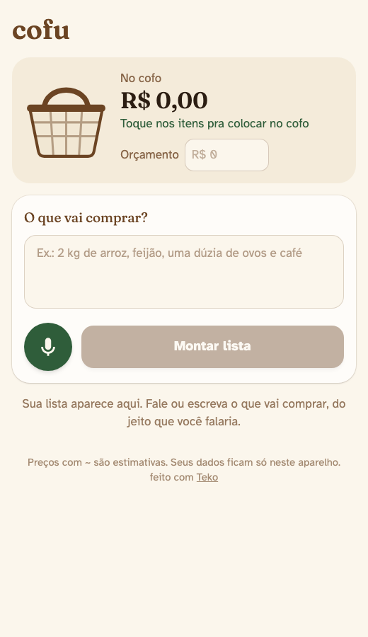
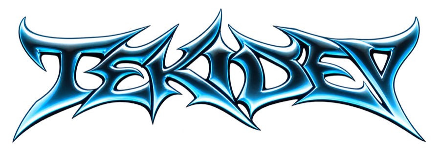

<p align="center">
  
</p>

# teko 🦾

**Seu JARVIS de código aberto:** várias IAs, uma memória, zero Ultron.

> Sabe o Visão, que carrega o JARVIS, a Sexta-Feira, a E.D.I.T.H. e até o Idiota e o Você dentro do próprio código?
> O Teko é isso, só que pra IA no mundo real: Claude, GPT, Gemini, DeepSeek, Grok, Ollama e companhia morando no mesmo lugar, dividindo a mesma memória e passando a bola quando uma delas cai.
> O Ultron fica de fora. Nenhuma IA escreve um arquivo ou roda um comando sem você dizer "pode".

Feito no Maranhão por **Felipe Oliveira** ([@tekiidev](https://github.com/tekiidev)). Teki Industries.

## Por que "Teko"

- 🗣️ **Pronúncia:** "TÉ-ko", com a força na primeira sílaba, rimando com Teki (não é "te-KÔ")
- Vem de **Teki**, o apelido de quem fez
- Em guarani, *teko* quer dizer algo como "modo de ser, jeito de viver"
- A ideia é essa: um jeito só de trabalhar com todas as IAs, em vez de uma aba pra cada

## O que o Teko faz

- 🧠 **Uma memória pra todas:** projetos, decisões, bugs e documentos entram no contexto do modelo escolhido, e agentes como Claude Code, Codex e Antigravity podem consultar a mesma base via MCP
- 🔁 **Troca de modelo sozinho:** se o modelo cai, estoura a cota ou dá timeout, o Teko tenta o próximo da fila
- 💸 **Ajuda a controlar o gasto:** perfis com fila de modelos (incluindo um modo econômico), orçamento por modelo e registro de tokens e custo de cada conversa
- 🛡️ **Segurança desde o começo:** roda local, as chaves ficam no banco da sua máquina, as ferramentas ficam presas à pasta do projeto e escrita ou execução pedem a sua aprovação
- 🏠 **Local primeiro:** banco SQLite e busca rodam na sua máquina. O que você manda no chat vai para o provedor de IA que você configurou, sob os termos dele

> O Teko está em desenvolvimento e é fornecido **sem garantia**, como diz a [AGPL 3.0](LICENSE) nas seções 15 e 16. Revise o que as IAs propõem antes de aprovar e use por sua conta e risco.

Backend TypeScript executado com `tsx`, sem etapa de build. Requer Node 22.5+ (`node:sqlite`).

## Rodar

```bash
git clone https://github.com/tekiidev/teko.git && cd teko
npm install
cp .env.example .env      # opcional: preencha as chaves que você tem
npm start                 # npm run dev recarrega sozinho
npm run typecheck         # checa todos os pacotes via Turborepo
npm test                  # testes (node:test); a CI roda estes dois em cada PR
npm run index             # reindexa os projetos com caminho local
npm run teko -- "oi"      # Teko no terminal (veja abaixo)
```

Abre `http://127.0.0.1:4780`.

As chaves também podem ser cadastradas pela aba **Conexões** — ficam no SQLite local (`data/teko.db`, com permissão do seu usuário).

## Terminal

O mesmo Teko (modelos, memória, chaves, cache e skills) direto no terminal:

```bash
cd apps/cli && npm link   # uma vez: instala o comando `teko`
teko                      # abre a conversa
teko "como reverto o último commit sem perder as mudanças?"
cat erro.log | teko "explica esse erro"
teko -c                   # continua a última conversa
teko uso                  # tokens, custo e economia
teko modelos              # fila do perfil e o que está pronto
teko limpar               # apaga conversas (todas, só voz ou só do projeto), pede confirmação
```

Sem `npm link`: `npm run teko -- "pergunta"`.

- Dentro de uma pasta cadastrada na aba Projetos, o projeto entra no contexto sozinho (e as ferramentas de arquivo ficam ativas)
- Ferramentas que alteram algo pedem confirmação no próprio terminal
- `/desfazer` (ou "Teko, desfaz isso" na voz) volta o que a IA escreveu nesta conversa, com aprovação; se você mexeu no arquivo depois, ele não passa por cima
- `teko limpar` apaga só do banco local (`data/teko.db`); o histórico de custo fica, e o que cada provedor guarda das chamadas de API segue a política dele
- Na conversa: `/modelo` (`/model`, `/models`, `/switch`), `/perfil` (`/profile`), `/projeto` (`/project`), `/nova` (`/new`, `/clear`), `/uso` (`/usage`), `/limpar` (`/apagar`), `/skills`, `/semcache` (`/nocache`), `/sair` (`/exit`, `/quit`) e qualquer skill (`/vagas ...`)
- Escolhas (modelo, perfil, aprovações, limpar) são com ↑ ↓ e Enter; Esc cancela
- `/models` lista os modelos com chave (`/models todos` mostra tudo); `/modelo gemini-flash-latest` troca direto e aceita o nome curto; Tab completa comandos, modelos, perfis e projetos; ↑ volta mensagens
- Linha terminando em `\` continua na próxima; Ctrl+C interrompe a resposta
- `NO_COLOR=1` desliga as cores

## Ajuda: comandos e gestos

Tudo que dá pra fazer (voz, gestos, mapa, terminal, delegar, skills) fica numa lista só, em `packages/ai/src/help.ts`:

- Terminal: `teko ajuda`, `teko --help` ou `/help` na conversa
- Mapa: botão **?** ou tecla **?**
- `GET /api/help` devolve a lista em JSON

## Voz no Mac

Fale **"Teko"** (ou segure **⌥ Espaço**): o Teko transcreve no próprio Mac, responde e fala, com uma aura de pixels por cima da tela que muda quando ele ouve, pensa e fala.

- "Teko, qual a capital do Maranhão?" numa frase só já vai direto
- "Teko" sozinho: um bipe, e ele espera você falar (termina quando você para)
- Comandos que o app resolve na hora, sem IA (falando ou digitando na ilha): "Teko, abrir mapa neural", "Teko, farmar aura" (liga a aura), "Teko, brochar" (desliga), "Teko, ativar gestos" / "desativar gestos" e "Teko, autodestruir" (responde "Foi um prazer, senhor." e fecha o Teko)
- **Abrir junto com o Mac**: no menu da barra. Ao abrir, o app sobe sozinho o servidor do Teko e a voz clonada (se estiver instalada) quando eles não estiverem rodando; logs em `data/logs/`. Ao sair, encerra só o que ele mesmo abriu
- **Estalo de dedos** também chama: precisa ser um estalo agudo e sozinho, então voz, batida na mesa, digitação e estalos em ritmo (música) não disparam. Desliga em "Ligar com estalo de dedos" no menu da barra O estalo também liga a aura, que fica na tela (parada, girando devagar); juntar as mãos (palma com palma) desliga
- "Teko, abre o Spotify": abre apps instalados pelo nome (Mac, Linux e Windows), sem aprovação, só o que estiver instalado; a resposta diz se ele viu o app abrir
- **Mover a aura**: pinça com uma mão segura e arrasta; pinça com as duas mãos afastando ou aproximando troca entre 3 tamanhos (pequena, padrão, grande), com a câmera acompanhando. A posição fica salva; "Centralizar aura" no menu da barra volta pro meio
- **Ilha no notch**: no topo da tela, colada no notch da câmera. Parada, some no notch; em conversa, cresce com o estado e a legenda; com o mouse em cima, abre Falar, Mapa, Parar, um campo pra pedir digitando e o gasto do dia. Sem notch, vira uma pílula pequena no topo. Liga e desliga no menu da barra

```bash
brew install whisper-cpp rust   # uma vez
npm run voice:setup             # baixa os modelos de transcrição (~615 MB, uma vez)
npm start                       # o servidor do Teko precisa estar rodando
npm run voz                     # abre o app (ícone na barra de menu)
```

- Transcrição local com whisper.cpp
- Voz: a sua, clonada localmente (abaixo); sem ela, cai na voz masculina do macOS (`say`, Reed)
- Escuta do "Teko" liga/desliga no menu da barra ("Ativar falando \"Teko\""); desligada, o microfone só abre enquanto você segura o atalho
- Com a escuta ligada o microfone fica aberto (o macOS mostra o ponto laranja). O áudio é processado no próprio Mac: um detector de volume recorta trechos curtos e o whisper local confere se começam com "Teko". Depois da ativação, só o texto transcrito da pergunta vai pro modelo de IA da fila (Gemini, Claude etc.)
- Só vale como primeira palavra ("ei/oi Teko" também); enquanto o Teko fala, ele não se escuta
- Respostas pelo perfil **Voz**: curtas e faladas, sem markdown
- Na primeira vez, o macOS pede permissão de microfone

### Voz clonada (local)

O Teko pode falar com a sua voz e o seu sotaque, usando o [Chatterbox](https://github.com/resemble-ai/chatterbox) multilíngue (licença MIT) em MLX ([mlx-audio](https://github.com/Blaizzy/mlx-audio)), nativo do chip da Apple, a partir de uns 30 segundos de gravação. Na primeira vez o modelo é baixado.

```bash
python3.11 -m venv data/voice-mlx && data/voice-mlx/bin/pip install mlx-audio   # uma vez
npm run voz:referencia                          # mostra o texto sugerido pra gravar
npm run voz:referencia -- ~/Downloads/voz.m4a   # converte a gravação
npm run voz:clone                               # deixe rodando junto com o npm start
```

- A gravação fica em `data/voice` (fora do git) e o servidor de voz escuta só em `127.0.0.1`
- Grave só a sua voz, ou a de alguém que autorizou por escrito
- Velocidade: num MacBook M5 com 16 GB, o modelo 8-bit (padrão) gera a fala mais rápido do que ela é falada (~0,7 a 1 s por segundo de fala), então não sobra pausa entre frases; na versão PyTorch levava de 15 a 60 s por frase. `TEKO_TTS_MODEL=mlx-community/chatterbox-4bit` é ainda mais rápido
- Semelhança: o modelo usa só ~10 s da gravação, então grave falando direto, sem pausas longas e sem música; áudio comprimido (tirado de vídeo ou gravação de tela) piora o resultado
- Ajustes: `TEKO_TTS_CFG` (0.5), `TEKO_TTS_TEMPERATURE` (0.8), `TEKO_TTS_EXAGGERATION` (0.1); modelo em `TEKO_TTS_MODEL`

## Cofu

App da feira, para qualquer pessoa: fale ou escreva o que vai comprar e o Cofu monta a lista. Funciona offline (a IA só online). Fica em `apps/cofu` e é feito com o Teko.

<p align="center"></p>

```bash
npm run cofu              # http://localhost:4790 (usa o GOOGLE_API_KEY do .env da raiz)
```

- Lista por texto ou voz (microfone do navegador); a IA devolve item, quantidade, unidade, categoria e preço estimado, validados com Zod
- Sem internet ou se a IA falhar, um leitor simples no aparelho monta a lista mesmo assim
- Tocar no item = ele cai no cofo; o cofo enche e muda de cor quando passa do orçamento
- "Tem em casa" vai pra prateleira; "Nova feira" esvazia o cofo
- Dados só no aparelho (IndexedDB); a chave da IA fica no servidor, com limite de pedidos por IP
- Preços são estimativas da IA, não preços reais de mercado (isso é a fase 2)

## O que já funciona

- **Chat com roteamento por perfil** — `código`, `projeto/arquitetura`, `documentação`, `revisão`, `bug`, `caveman (econômico)`.
- **Modo Caveman (Econômico)** — respostas telegráficas e ultra-densas que cortam até ~75% de tokens sem perder substância técnica.
- **Ferramentas no chat** — o modelo lista e lê arquivos, busca com regex, escreve, edita e roda comandos. Escrita e execução pedem **aprovação** na própria bolha.
- **Busca no projeto** — índice local FTS5 (BM25) sobre código, docs, memória, decisões e bugs. Os melhores trechos entram automaticamente no contexto da conversa.
- **Fallback automático** — 429, cota esgotada, chave inválida, 5xx, timeout: o modelo entra em cooldown e a fila continua.
- **Prompt caching**: o system prompt fica estável entre mensagens (data e trechos da busca vão junto da mensagem), com breakpoints de cache na Anthropic e aproveitamento do cache automático de OpenAI, Gemini e DeepSeek. Tokens em cache, latência e economia estimada ficam registrados por chamada.
- **Cache local de respostas**: a mesma pergunta no mesmo contexto volta do SQLite, sem nova chamada ao modelo. Vale só para conversas sem ferramentas, expira em 24 h (configurável) e o botão "Sem cache" força uma resposta nova. Cada acerto fica registrado como `cache_hit`, com o custo poupado.
- **Compressão do histórico**: quando a parte não resumida da conversa passa de ~12 mil tokens (configurável), as mensagens antigas viram um resumo feito por um modelo barato e só as últimas vão inteiras. O resumo fica salvo na sessão e só muda na próxima compressão, então o começo da conversa continua aproveitando o cache do provider.
- **Escolha manual + fallback** — se você escolher um modelo e ele cair, os seguintes do perfil continuam valendo.
- **Uso** — tokens e custo por sessão, hoje, semana, mês e total; série de 14 dias; quebra por modelo e provider.
- **Orçamento por modelo** — limite de tokens por semana/mês; ao estourar, o modelo sai da fila.
- **Projetos** — descrição, stack, caminho do repo (`git ls-files` entra no contexto), decisões (ADR-lite) e memória/documentos.
- **Bugs** — severidade, status, reprodução, esperado/atual, logs, tags; export JSON e Markdown pro projeto separado de bugs.
- **Memória contínua e resumo de sessão** — condensa a conversa e persiste aprendizados na memória do projeto.
- **Google Drive/Docs** — OAuth, busca e importação de Docs/Sheets como memória do projeto.
- **Figma** — token pessoal, leitura de páginas/frames/textos e importação como memória do projeto.
- **Sync de modelos** — puxa a lista real de cada provider e deixa os novos desativados pra revisão.

## Arquitetura

Monorepo com npm workspaces + Turborepo.

```
packages/
  ai/                     @teko/ai: o orquestrador
    src/
      config.ts           .env, data/ e porta (lidos da raiz do repo)
      db.ts               schema SQLite + seed
      chat.ts             um turno completo de chat (usado pelo painel e pelo terminal)
      catalog.ts          providers, modelos, perfis e preços iniciais
      router.ts           fila, fallback, cooldown, orçamento e loop de ferramentas
      context.ts          monta o system prompt do projeto
      approvals.ts        aprovações pendentes de ferramentas
      search-index.ts     índice FTS5 + busca BM25 + trechos pro prompt
      tools/              fs | search | shell | catálogo de ferramentas
      usage.ts            agregações de tokens/custo
      sync.ts             descoberta de modelos por provider
      providers/          anthropic | openai-compatible | google
      connectors/         google (OAuth + Drive) | figma (token + outline)
    scripts/              index | reset
apps/
  teko/                   @teko/app: painel local e servidor MCP
    src/server.ts         HTTP + SSE + rotas
    src/mcp.ts            contexto compartilhado com agentes via MCP stdio
    src/discover-projects.ts
    public/               SPA vanilla (sem build)
  cli/                    @teko/cli: comando `teko` no terminal
    bin/teko.mjs          entrada (carrega o TypeScript via tsx)
    src/cli.ts            conversa, pergunta única e comandos
  teko-desktop/           @teko/desktop: voz no Mac (Tauri) com a aura
    web/                  aura (canvas) e fluxo de voz
    src-tauri/            atalho global, janela transparente, barra de menu
  cofu/                   @teko/cofu: app da feira (Next.js, PWA offline)
    src/app/api/lista     rota da IA (só servidor)
    src/lib/              leitor sem IA, IndexedDB, orçamento
```

Os apps importam o orquestrador por subcaminho, por exemplo `@teko/ai/router`.

Próximos espaços previstos: `packages/career-core`, `packages/finance-core`, `apps/teko-desktop`.

### Como o fallback decide

1. Monta a fila do perfil (ou começa pelo modelo escolhido).
2. Remove desativados, sem chave, em cooldown e acima do orçamento.
3. Tenta em ordem. Em falha, grava cooldown conforme o erro:
   - `429` → usa `Retry-After` ou 15 min
   - `401/403` → 30 min
   - `402` / "quota"/"insufficient" → 12–24h
   - `5xx`/rede → 3 min
4. Em sucesso, limpa o cooldown e registra uso.

O cliente recebe eventos SSE (`attempt`, `delta`, `fallback`, `tool_call`, `tool_decision`, `tool_running`, `tool_result`, `done`, `error`) e mostra a troca de modelo e as ferramentas na própria bolha.

## Ferramentas no chat

Com um projeto que tem caminho local, o modelo ganha seis ferramentas:

| Ferramenta | Aprovação | O que faz |
| --- | --- | --- |
| `list_files` | não | árvore de arquivos (profundidade 1–6) |
| `read_file` | não | lê arquivo com números de linha |
| `grep` | não | regex no conteúdo, com filtro de glob |
| `search_project` | não | busca por relevância no índice do projeto |
| `write_file` | **sim** | cria/sobrescreve arquivo |
| `edit_file` | **sim** | substitui trecho exato |
| `run_command` | **sim** | shell dentro do projeto (timeout 120s) |

É aqui que o Ultron fica preso. Tudo fica restrito ao caminho do projeto: `../` e caminhos externos são bloqueados. Comandos destrutivos óbvios (`rm -rf /`, `sudo`, `mkfs`, `dd if=`) são recusados antes da aprovação. Aprovações expiram em 5 minutos; se você fechar a aba, a execução é cancelada.

## Maestro: Teko delega pro Claude Code

O Teko não tenta programar melhor que um agente de código: ele **delega**. Com um projeto com caminho local ativo, a ferramenta `delegate_agent` roda o [Claude Code](https://docs.anthropic.com/en/docs/claude-code) sem interface (`claude -p`) dentro do projeto e devolve o resumo, o custo e os arquivos que mudaram.

**Dupla com revisão cruzada:** depois que o Claude Code implementa, uma IA de **outra empresa** (GPT-5.5, ou Gemini Pro de reserva) revisa o diff. Se ela apontar problema médio ou grave, o Claude Code corrige uma vez. O relatório traz o que mudou, o que o revisor pegou e o custo de cada agente (que também vai pra aba Uso). Num teste, implementar uma função custou US$ 0,36 no Claude Code e US$ 0,002 na revisão. `TEKO_AGENT_REVIEW=0` desliga a revisão; `TEKO_REVIEWER` escolhe o revisor.

- Sempre pede aprovação antes (no painel e no terminal)
- O Claude Code só edita arquivos (`--permission-mode acceptEdits`), não roda comandos por conta própria e não commita
- Limite por tarefa: `TEKO_AGENT_MAX_USD` (padrão US$ 2) e `TEKO_AGENT_TIMEOUT_MS` (padrão 15 min)
- Precisa do Claude Code instalado (`claude` no PATH ou `CLAUDE_BIN`)
- Num teste, corrigir um bug de uma linha custou ~US$ 0,19 e levou ~11 s
- Trocar de projeto falando ou escrevendo: "Teko, trabalha no projeto Cofu", "sai do projeto" (resolvido localmente, sem gastar IA)
- Na voz: o Teko pergunta "Posso mandar pro Claude Code: …?" e você responde **"sim"/"pode"** ou **"não"**, ou faz **pinça** (polegar no indicador) pra confirmar. Sem resposta clara, ele nega. **Esc** cancela

## Busca local

O índice usa **FTS5 do próprio SQLite** (`unicode61`, sem acento), com BM25 e trechos destacados. Sem embeddings, sem serviço externo, sem dependência.

- Indexa código e docs do repo + memória, decisões e bugs do projeto.
- `POST /api/search/index` reindexa; o índice também é criado ao salvar o caminho do projeto.
- Na conversa, os 5 trechos mais relevantes da sua mensagem entram no system prompt (RAG local).
- A aba **Projetos** tem busca com `arquivo:linha` e trecho destacado.

## Skills

Skills são pastas com um `SKILL.md` (mesmo formato das skills do Claude): frontmatter com `name` e `description`, e as instruções em Markdown.

- Ficam em `data/skills/`, **fora do git**, porque costumam ter dados pessoais
- O system prompt leva só o índice (nome + descrição), que é estável e fica no cache do provider
- `/nome` no começo da mensagem ativa a skill só naquela mensagem, sem chamada extra ao modelo. Ex.: `/vagas <texto da vaga>`
- Em projetos com ferramentas, a IA pode carregar a skill sozinha com `use_skill`

Importar do Claude (`~/.claude/skills`):

```bash
npm run skills:import                 # lista o que dá pra importar
npm run skills:import -- vagas        # importa por nome
```

Pela API: `GET /api/skills`, `GET /api/skills/importable`, `POST /api/skills/import` (`{ "names": [...] }`), `DELETE /api/skills/:nome`.

## API

| Método | Rota | Uso |
| --- | --- | --- |
| GET | `/api/bootstrap` | estado completo do dashboard |
| POST | `/api/chat` | SSE: conversa com fallback |
| GET | `/api/route?profileId=&modelId=` | prévia da fila e motivos de skip |
| GET | `/api/usage` | agregações de uso |
| GET | `/api/search?q=&projectId=` | busca no índice (BM25) |
| GET | `/api/search/status?projectId=` | estado do índice |
| POST | `/api/search/index` | reindexar projeto |
| GET | `/api/approvals` | aprovações pendentes |
| POST | `/api/approvals/:id` | aprovar/negar (`{ approved }`) |
| GET/POST/PATCH/DELETE | `/api/sessions…` | conversas |
| POST | `/api/sessions/:id/summarize` | resumo da sessão |
| GET/POST/PATCH/DELETE | `/api/projects…` | projetos |
| GET/POST/PATCH/DELETE | `/api/decisions…` | decisões |
| GET/POST/PATCH/DELETE | `/api/bugs…` | bugs |
| GET | `/api/bugs/export?format=json\|md` | export pro app de bugs |
| GET/POST/DELETE | `/api/memory…` | memória/documentos |
| PATCH | `/api/models?id=` | ativar, preço, orçamento |
| POST | `/api/models/sync` | descobrir modelos |
| POST | `/api/keys` | salvar chave por provider |
| GET | `/api/google/auth` | iniciar OAuth |
| GET | `/api/google/search?q=` | buscar no Drive |
| POST | `/api/google/import` | importar doc como memória |
| GET | `/api/figma/status` | estado da conexão |
| GET | `/api/figma/file?url=` | outline do arquivo (sem salvar) |
| POST | `/api/figma/import` | importar arquivo como memória |

## Google Drive

1. Crie um OAuth client **Desktop app** no Google Cloud Console.
2. Ative a Drive API.
3. Coloque `GOOGLE_CLIENT_ID` e `GOOGLE_CLIENT_SECRET` no `.env`.
4. Aba **Conexões → Conectar**.

Redirect URI usado: `http://localhost:4780/api/google/callback`.

## Figma

1. Gere um **Personal Access Token** em Figma → Settings → Security (escopo de leitura de arquivo).
2. Cole na aba **Conexões → Figma** ou defina `FIGMA_TOKEN` no `.env`.
3. Cole a URL do arquivo (`https://www.figma.com/design/<key>/...`) e importe para um projeto.

O que entra no contexto: nome das páginas, tipos e nomes dos frames, dimensões e os textos encontrados (até ~1200 nós).

## Integração com o OpenCode

O teko é um serviço local. Pra reaproveitar o roteamento dentro do OpenCode, o caminho mais direto é um plugin/MCP que chame `POST http://127.0.0.1:4780/api/chat` (SSE) — as sessões e o uso continuam sendo registrados aqui.

## Contexto para Claude Code, Codex e Antigravity

O Teko inclui um servidor MCP local (`npm run mcp`) para compartilhar projetos, preferências, decisões, bugs e notas duráveis entre agentes. A busca retorna poucos trechos do índice local; o servidor não envia o histórico completo das conversas. Configure o mesmo servidor em cada cliente e cadastre os caminhos dos repositórios na aba Projetos.

Veja [como conectar os agentes e organizar o contexto](docs/CONTEXTO_UNIFICADO.md).

## Próximos passos sugeridos

- Embeddings locais (Ollama) como segunda perna da busca, mantendo o FTS5 como fallback.
- Regras de roteamento por intenção (detectar review/bug automaticamente).
- Webhooks: bug criado → abre issue no GitHub.
- Criptografia das chaves em repouso (hoje ficam no SQLite local).
- Diff visual antes de aprovar escrita/edição.

## Licença

O Teko é open source sob a **[AGPL 3.0](LICENSE)**. Criado por **Felipe Oliveira** (Teki Industries).

- ✅ Pode usar, estudar, modificar e compartilhar à vontade
- ✅ Pode rodar pra você, pro seu time ou pra sua empresa
- 📌 Toda cópia ou fork mantém o crédito ao autor e o aviso do [NOTICE](NOTICE)
- 🔓 Se modificar e distribuir, ou oferecer como serviço online, o código tem que continuar aberto sob a AGPL
- 🏷️ Os nomes **Teko**, **Teki**, **Teki Industries** e **Cofu** não vêm junto com o código: fork tem que ter outro nome (nada de "Teko Pro"). Veja [TRADEMARKS.md](TRADEMARKS.md)
- 💼 Quer usar num produto fechado ou vender sem abrir o código? Isso pede uma **licença comercial**. Fala com [@tekiidev](https://github.com/tekiidev)

Contribuições são bem-vindas. Ao abrir um PR, você concorda que sua contribuição pode ser distribuída sob a AGPL 3.0 e sob a licença comercial do Teko.

## Reset

```bash
npm run reset -- --yes
```

Apaga o banco local. É o protocolo "Casa Limpa" do Teko: use com consciência.

---

Teko não tem relação com a Marvel. A gente só é fã mesmo. 🦾

<p align="center">
  Feito por<br />
  <a href="https://github.com/tekiidev"></a>
</p>
